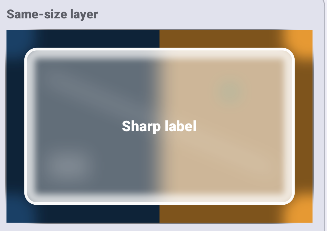

## 7.9 - outer shadow

**Offset down** — fixed. Teaching: `8` CSS px. iOS: `4` pt. This is a convention that more of the halo sits below the card. It is not a simulated sun.

Stage pad = 32 px, which is ≥ maximum blur 24 + offset 8.

**Questions**:

Why the corner squares are not covered by shadow?



```swift
let rect = CGRect(
    x: stagePad,
    y: stagePad + shadowOffsetY,
    width: size.width - 2 * stagePad,
    height: size.height - 2 * stagePad
)
```

Why start `y` at `stagePad + shadowOffsetY` and keep height at `size.height - 2 * stagePad`?

## 7.10 - Fine noise or dither

Fine noise is a small signed offset added to a pixel before that store. 

Dither is the use of that offset so neighboring pixels can round to different integers and the eye averages the field.

```
column = 200   row = 80
true red = 0.333   ← slow ramp at this column
unit = ((200 + 3) × 7 + (80 + 5) × 13) remainder 16 ÷ 15
     = 14 / 15
     = 0.933
signed = 2 × 0.933 − 1 = 0.867
amount = 0.12   ← slider
```

Lesson 3.1: stored red = round(true red × 255). At column 200, true red = 0.333. Stored red with amount 0 = 85. Nearby columns with true red in the same rounding bin keep that same integer. The run is a stripe.

**Questions**

Amount 0.12 on chroma looks dirtier than the same amount on luminance. → not clear what’s chroma and luminance in this case.

Why do we get perfect stripes, is there anything special behind the math with this formula?

There’s odd Black around the **Interactive lab** example - if that was meant to be shadow there’s an error somewhere.

Chroma noise - in section two it seems **Luminance noise** and **Chroma noise** look pretty identical apart from the latter being darker (viewed on a browser)?

The numbers `7`, `13`, `3`, and `5` are chosen so the 16-slot table is easy to compute by hand. They are not a claim about camera sensors or film. - what’s meant by that?

A large luminance amount can also look dirty, but the specks stay gray. - what’s meant by that?

Adding one small signed offset, from a fixed column-and-row recipe, to all three channels before that **store** breaks the stripes without colored dirt. - what’s meant by store? what’s meant here?